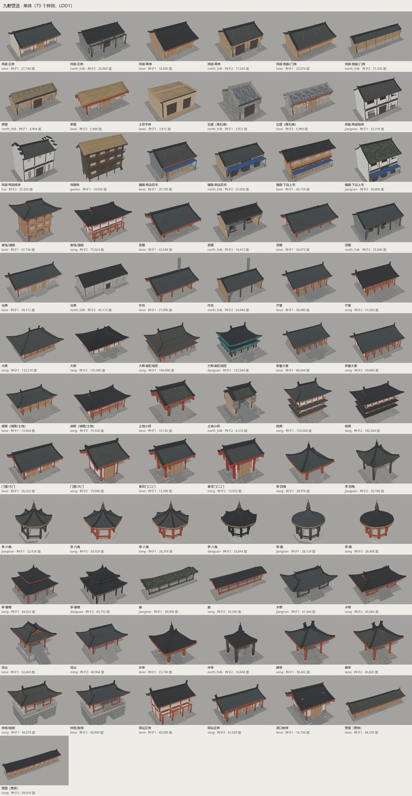
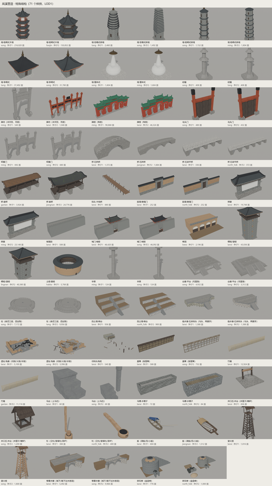
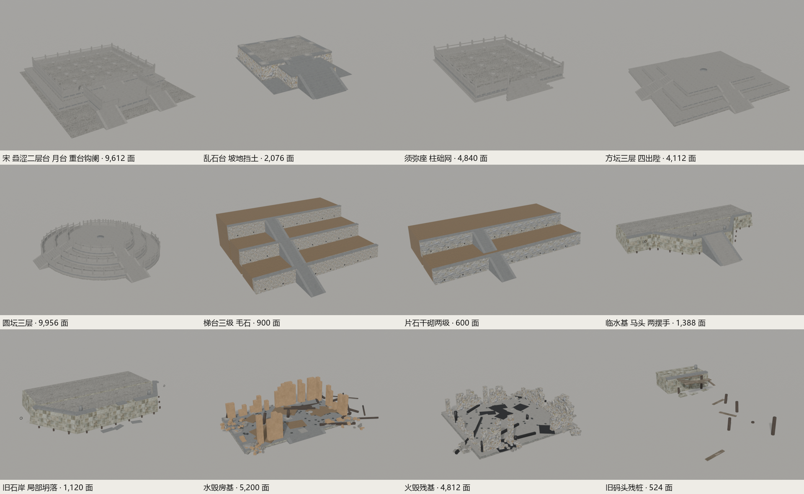
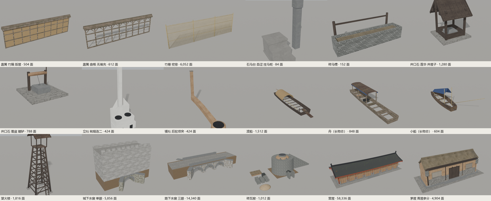

# 九野营造 Jiuye Yingzao

一个 Blender 插件，以宋《营造法式》的规则为骨架，参数化生成中国古代建筑，并可导出到 Unity 等游戏引擎。

A Blender add-on that generates Chinese historical buildings parametrically from the rules of the Song-dynasty *Yingzao Fashi* (营造法式), with export for game engines such as Unity.



## 能力 / Features

| 项 | 数量 |
|---|---|
| 可生成类型 | **87**：单体 38、特殊结构 38、组群 10、现代 1 |
| 风格 | 16：唐、宋、辽金、明，九类地方民居，观宇，岚溪；清官式保留但弱化（自动选择时不会选到） |
| 屋顶 | 11 种：四阿、九脊、不厦两头、硬山、卷棚、卷棚硬山、盝顶、攒尖、圆攒尖、单坡、平顶；另有副阶、腰檐 |
| 瓦作 / 脊饰 | 7 种瓦作（筒瓦、合瓦、平板、茅草、石板、树皮、剖竹），可加琉璃剪边；7 种脊饰 |
| 台基 | 7 种剖面（含叠涩坐、十三层须弥座），多层，月台，6 种踏道，单/重台钩阑，6 种柱础，坡地挡土 |
| 材质 | 76 种，来自 38 套 ambientCG CC0 贴图；墙、屋面、剪边按风格随种子抽取 |
| 层数与层高 | 层数不设上限；每层层高可单独设定（单体、塔、碉楼、土楼、现代楼） |
| 细节等级 | LOD0 / 1 / 2 |
| 导出 | GLB、glTF（共享贴图）、FBX；规格参数写在根节点自定义属性里 |

**规则（摘录）：**
- 大木作：材分八等、举折、生起、侧脚、梭柱、出际、檐出、铺作。
- 瓦作：用瓦、鸱尾、兽头。
- 石作与砖作：殿阶基、踏道、钩阑、柱础、须弥坐、马台、井口石、卷輂水窗、垒造窑。
- 小木作：露篱、井屋子；泥作：立灶、釜镬灶、茶炉。
- 功限：望火楼、营屋。
- 《考工记》：葺屋参分、瓦屋四分。
- 《长物志》：舟、小船。

完整规则、参数与出处见 [技术手册.md](技术手册.md) 和自动生成的 [技术手册_附表.md](技术手册_附表.md)。

| 特殊结构 | 台基与遗址 | 街巷杂件与工程 |
|---|---|---|
|  |  |  |

## 安装 / Install

需要 Blender 4.2 或更高版本，已在 4.5 上测试。

1. 从 Releases 下载 `jiuye_yingzao.zip`，或者在仓库根目录运行 `py -3.12 tools/package.py` 自己打包。
2. 在 Blender 中打开 编辑 → 偏好设置 → 插件 → 从磁盘安装，选择这个 zip。
3. 在 3D 视图侧栏打开"九野营造"面板，选择类别、类型、风格和种子，然后点"生成"。

命令行与 Python：

```
blender -b --factory-startup --python tools/build_catalog.py -- --variants 2
```

```python
from jiuye_yingzao import catalog
root = catalog.generate('dadian', 'song', seed=3, lod=1, found='diezhe', balustrade='chong')
```

## 授权 / License

- 代码与数据：**GPL-3.0-or-later**（`LICENSE`）。
- 文档与图片：**CC BY-NC-SA 4.0**（`LICENSE-DOCS`）。
- **商业使用：** 不符合 GPL-3.0 的商业使用（例如闭源集成），以及文档与图片的任何商业使用，都须事先取得作者的商业授权。详见 [LICENSING.md](LICENSING.md)。

## 参与贡献 / Contributing

欢迎 PR。贡献者先同意 [CLA.md](CLA.md)，合并后记入 [CONTRIBUTORS.md](CONTRIBUTORS.md)，署名为合作者。项目如有商业授权收入，按贡献点数比例分配（CLA 第 6 条）。流程见 [CONTRIBUTING.md](CONTRIBUTING.md)。

## 使用的资源 / Resources used

**文献（公有领域，文本取自中文维基文库 zh.wikisource.org，仓库不附带原文）**
- 《营造法式》（北宋 李诫，1103），全 34 卷及看详、目录：https://zh.wikisource.org/wiki/營造法式
- 《考工记》及宋 林希逸《考工记解》：https://zh.wikisource.org/wiki/考工記
- 《长物志》（明 文震亨）：https://zh.wikisource.org/wiki/長物志

**代码**
- [kang340/xingfuli-residential](https://github.com/kang340/xingfuli-residential)：MIT，© 2026 kang340。现代居民楼生成，原样保存在 `jiuye_yingzao/vendor/xingfuli/`。
- [lhlGitHub/threejs-architecture-effects](https://github.com/lhlGitHub/threejs-architecture-effects)：MIT，© 2026 Hailey。"共享边界高度函数使戗脊吻合"的屋面思路来自这里；本插件的屋面代码是重写的，没有复制源码，保留其声明。

**贴图**
- [ambientCG](https://ambientcg.com)：CC0 1.0，38 套。清单与哈希见 `jiuye_yingzao/data/material_sources*.json`，以及手册 §2.2。

**工具**
- [Blender](https://www.blender.org)（GPL）。

各组件的详细说明见 [jiuye_yingzao/THIRD_PARTY_NOTICES.md](jiuye_yingzao/THIRD_PARTY_NOTICES.md)。

---

© 2026 Xiangyu Lyu and the Jiuye Yingzao contributors.
